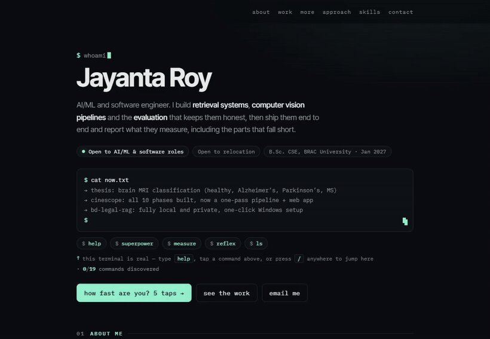
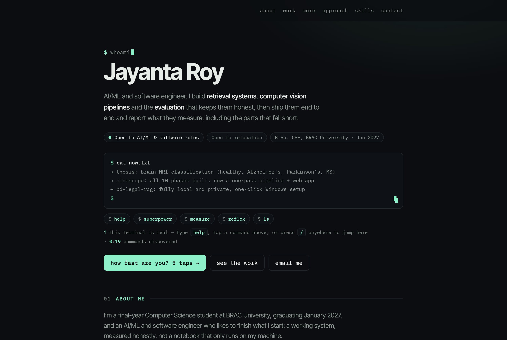
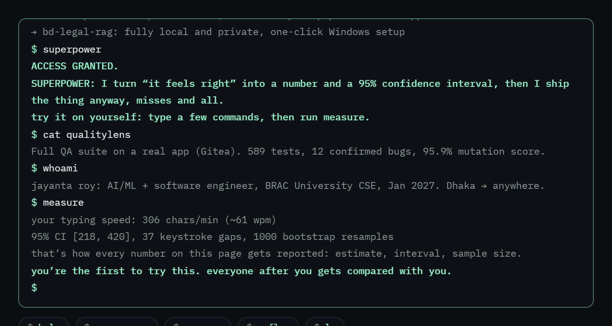
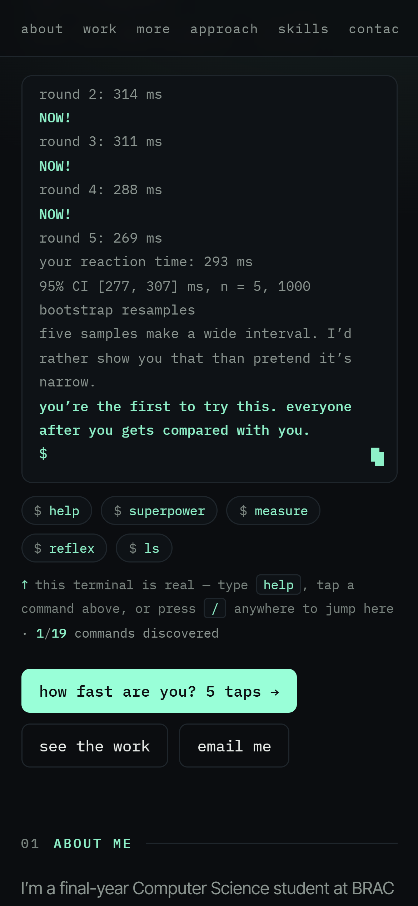
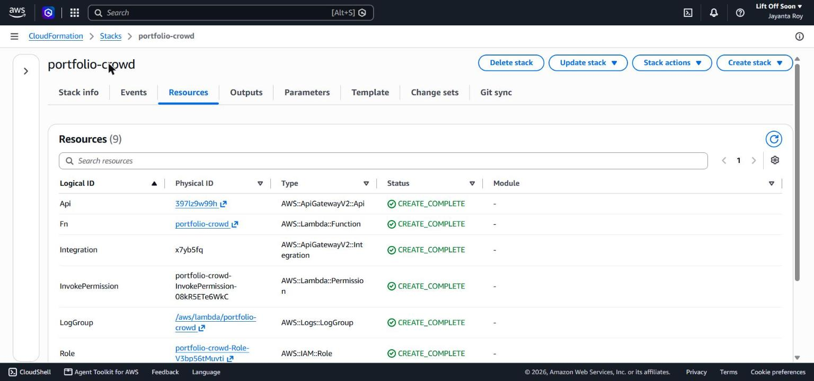
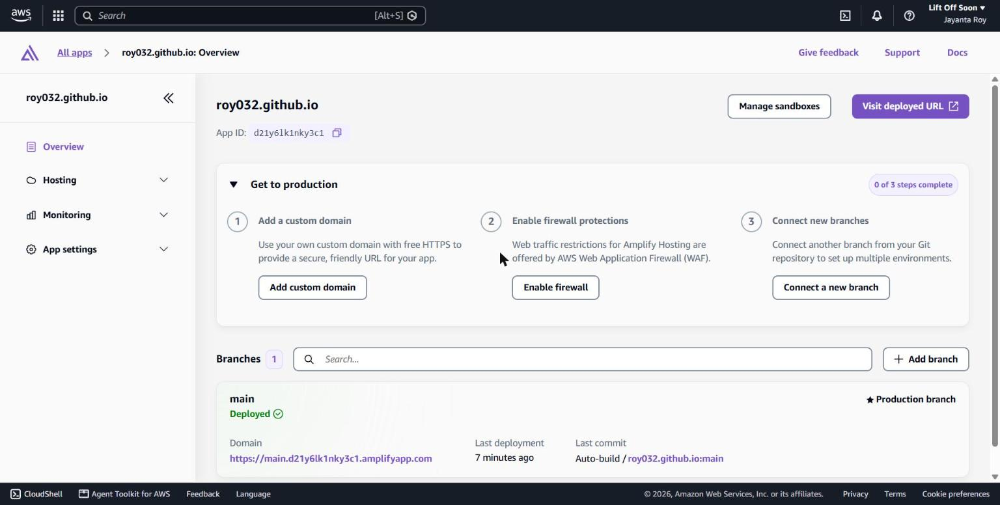
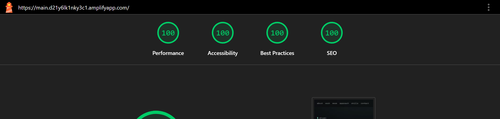

# A portfolio that measures you back: full write-up

**Live site (AWS Amplify):** https://main.d21y6lk1nky3c1.amplifyapp.com
**Entry for:** AWS Student Builder Challenge: Build Your Tech Superpower

I'm Jayanta, a final-year CSE student at BRAC University (Dhaka). Every project I build follows one rule: measure it before you trust it, and report the result with its uncertainty, including the parts that fall short. My portfolio's creative feature applies that rule to you, then compares you with everyone who came before you.



## How this was built: me plus an AI coding agent

I built this entry with **Claude Code** as my coding agent, the way the challenge's Day 2 guide suggests. Who did what:

- **Me:** the AWS account and project, the brief (keep my site's look, feature my finished projects, enter this challenge, be honest about AI, aim to win), the "measure first" principle the feature is built on (it was on my site before the challenge), every project shown, and every decision. I did the steps that need a human: signing in, authorizing Amplify on GitHub, and making repositories public. I reviewed what the agent produced and told it what to change.
- **Claude Code:** proposed the `measure`, `reflex` and crowd-comparison ideas from that principle, and wrote the HTML, CSS, JavaScript and the CloudFormation template. It also ran the tests, the Lighthouse audits and the link checks, fixed what they found, recorded the screenshots and demo, and drafted this write-up for me to review.

## The creative feature



**One click for skimmers.** The hero's main button, *"how fast are you? 5 taps →"*, starts the reaction test, so judges and visitors get the feature without typing anything.

**A real terminal for explorers.** Click it, or press `/` anywhere on the page:

| Command | What it does |
|---|---|
| `reflex` | Five-round reaction test you play by tapping (works on phones). Tap before the border turns green and the round restarts. Reports your mean with a 95% bootstrap interval, and says plainly that n = 5 makes it wide. |
| `measure` | Times the gaps between your keystrokes and reports your typing speed with a 95% bootstrap interval (1,000 resamples) and the sample size. Below 15 samples it refuses: *"I don't report numbers I can't defend."* |
| **you vs. the crowd** | After `reflex` or `measure`, your result is compared live with every earlier visitor, for example *"faster than 72% of the 412 visitors before you; given your own 95% interval, somewhere between 61% and 81%."* The uncertainty in your own result carries through to your rank. |
| `superpower` | Unlock animation, then: *I turn "it feels right" into a number and a 95% confidence interval, then I ship the thing anyway, misses and all.* |
| `ls`, `cat <project>`, `open <project>` | Explore the projects; `open` scrolls to the card and highlights it. |
| `about`, `projects`, `skills`, `contact` | Jump to a section. |
| `help`, `stats`, `whoami`, `hire`, `history`, `clear` | `hire` copies my email. Two more commands are hidden. |

There's also Tab completion, ↑/↓ history, tap-to-run chips for phones, a "x/19 commands discovered" counter with unlock notices (kept in your browser only), and a screen-reader live region for the output. The visible hint sits right under the terminal: *"this terminal is real: type help, tap a command above, or press / anywhere to jump here."*





*Screenshots and the demo were captured during testing, so the "visitors before you" in them are the capture script's own earlier runs. The table was emptied afterwards, so real visitors start from zero.*

## The three core sections

- **About me**: who I am, how I work, and what I'm finishing now (a thesis on brain MRI classification).
- **Skills**: languages, ML/CV, LLM systems, backend, testing and quality, networking, credentials.
- **Projects**: six featured projects (one is my in-progress thesis) with measured results and a link to each repository. For example, a bilingual legal RAG system (90.7% right section in the top 5), CineScope (10 computer-vision phases, each built from scratch and then benchmarked against the library), and QualityLens (589 automated tests, 12 confirmed bugs found in Gitea). More projects sit in a filterable grid.

## How it runs on AWS

```
                  git push
 GitHub (main) ────────────► AWS Amplify Hosting ──► CloudFront (HTTPS, Brotli) ──► the page
                                                                                       │
                       POST /score (CORS: this site only, throttled)                   │
 the page ─────────────────────────────────────────────────────────────────────────────┘
      │
      ▼
 API Gateway (HTTP API) ──► Lambda (Node.js 22) ──► DynamoDB (on-demand)
                              validate → read histogram → percentile → count
                              logs ──► CloudWatch Logs (14-day retention)
```

| AWS service | What it does here |
|---|---|
| **Amplify Hosting** | Serves the site with HTTPS through Amazon CloudFront with Brotli compression (both visible in the response headers). Every push to `main` redeploys automatically, in about 70 seconds each time we measured. |
| **API Gateway (HTTP API)** | Two routes: `POST /score`, and `GET /count` (just the number of results, shown on the page once there are 10). CORS allows only this site's origins, and the stage is throttled. |
| **Lambda** | Validates the result, reads the histogram, computes your percentile at your estimate and at both ends of your interval, then adds you to the count. |
| **DynamoDB** | One item per metric (`reflex`, `typing`) holding counts per bucket (10 ms or 10 chars/min). On-demand billing, so it costs nothing while idle. |
| **IAM** | The function's role can only `GetItem` and `UpdateItem` on that one table and write its own logs. |
| **CloudWatch Logs and Alarms** | The function's logs, kept 14 days, plus alarms on Lambda errors and API Gateway 5xx that publish to an SNS topic. |
| **CloudFormation** | Everything above (except Amplify) is one template: [`infra/crowd.yaml`](infra/crowd.yaml). |
| **AWS CLI v2 + `aws login`** | Browser sign-in with temporary credentials, so no access keys exist. `aws sts get-caller-identity` confirmed the right account before anything was deployed. |





**Privacy.** Only the result travels: the server stores a count in a bucket, with no IP address, no identifier and no raw samples.

**Cheat resistance.** Results outside human ranges, too few samples, or a reflex mean that doesn't match its five samples get `422` and are never counted. We tested a 50 ms "reaction", a mismatched mean and four samples instead of five; all were rejected.

**Static first.** If the API is down, the terminal says so and every result still works.

**Cost.** API Gateway, Lambda and DynamoDB all bill per request, so the backend costs nothing while idle. A burst test showed the limits holding: of 120 simultaneous requests, only 22 reached Lambda. API Gateway rejected 23, and Lambda's account concurrency limit shed 75.

## Measured, like everything else



Lighthouse 12.6 on the live Amplify URL, Nov 3, after the backend went in: **100 / 100 / 100 / 100 on both mobile and desktop** (performance, accessibility, best practices, SEO).

It didn't start there. The first audit, on a local copy before any fixes, scored 88 for mobile performance and 97 for accessibility. Part of that was the local server not compressing files, which Amplify does. The rest was three real problems:
- The dimmest grey text had a 3.3:1 contrast ratio. It's now the closest grey that passes WCAG AA (4.5:1) on all three backgrounds the site uses.
- The Google Fonts stylesheet blocked first paint (Lighthouse estimated 1.9 s on mobile). It now loads without blocking, with a fallback for visitors without JavaScript.
- A missing favicon caused a 404 console error. An empty icon fixed it.

## Built during the challenge

The site's repository dates from September, and an earlier version lived on GitHub Pages. Everything the rubric scores was built for this challenge, between Oct 28 and Nov 3: `index.html` grew from 234 to 708 lines, and the backend template is new. That covers:

- the interactive terminal and all 19 commands, including `measure`, `reflex` and the discovery counter
- the crowd comparison and its AWS backend
- the About me, Skills and Projects sections in their current form
- the AWS Amplify deployment
- the accessibility and performance fixes above

The full history is public in the commits.

## What this build showed

1. **Carry uncertainty all the way through.** A percentile from 5 taps isn't a single number. Computing the rank at both ends of the visitor's own interval, and saying how few people there are to compare against, is the same honesty I want in research results.
2. **Very low throttle limits backfire.** At 10 requests/second, API Gateway returned `429 Too Many Requests` to single requests sent seconds apart: a stage's allowance is split across API Gateway's fleet, so tiny limits throttle real traffic early. Raising it to 25/s fixed it, and Lambda's account concurrency still caps the worst case.
3. **Let the server decide what counts.** The browser can send anything, so plausibility checks live in the Lambda, not in the page.
4. **Short-lived credentials beat access keys.** `aws login` gives the CLI temporary credentials through browser sign-in, so there's no secret to leak or rotate.
5. **Browsers protect OAuth popups on purpose.** When the coding agent clicked "Update GitHub permissions" in Amplify, the GitHub window never opened. Popup blockers only allow `window.open` from a real user gesture, so granting access to my repositories had to be my own click. That's the right design: an agent shouldn't be able to grant itself access to my code.
6. **Measure the site, not just the visitor.** Lighthouse found three problems nobody could see by looking.

## Challenges along the way

- **Standing out among terminals.** At least 15 of the roughly 90 entries I looked at are terminal portfolios. The terminal here is just the doorway; the feature is measurement with honest uncertainty. Other entries count or rank visitors (a leaderboard, a visit counter), but none I saw reports your rank with an interval around it. That's also why the main button skips the terminal entirely.
- **A keyboard feature on phones.** The first `measure` only counted keystrokes, so a judge tapping chips on a phone could only ever get "not enough data". `reflex` measures taps instead, and `measure` now points phone users to it.
- **Wording at the edges.** Early test screenshots said "faster than 0% of the 2 visitors" and "between 0% and 0%", which read like bugs. The copy now says "slower than all 2 visitors" and drops the range when it doesn't add anything.
- **Content that never appeared.** The first scroll-reveal animation used an IntersectionObserver. In a background tab it never fired, so project cards stayed invisible. A scroll-position check with a timeout fallback replaced it.
- **CLI sign-in showed "no active sessions"** the first time, even though I was signed in to the console. Loading the sign-in page again listed my project session.

## Built with

HTML, CSS and vanilla JavaScript (no framework); AWS Amplify Hosting, API Gateway, Lambda, DynamoDB, IAM, CloudWatch Logs and CloudFormation; GitHub; AWS CLI v2. Built with Claude Code as my coding agent.
